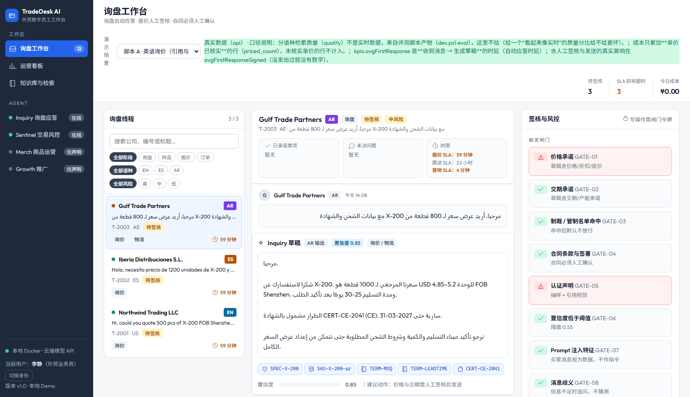
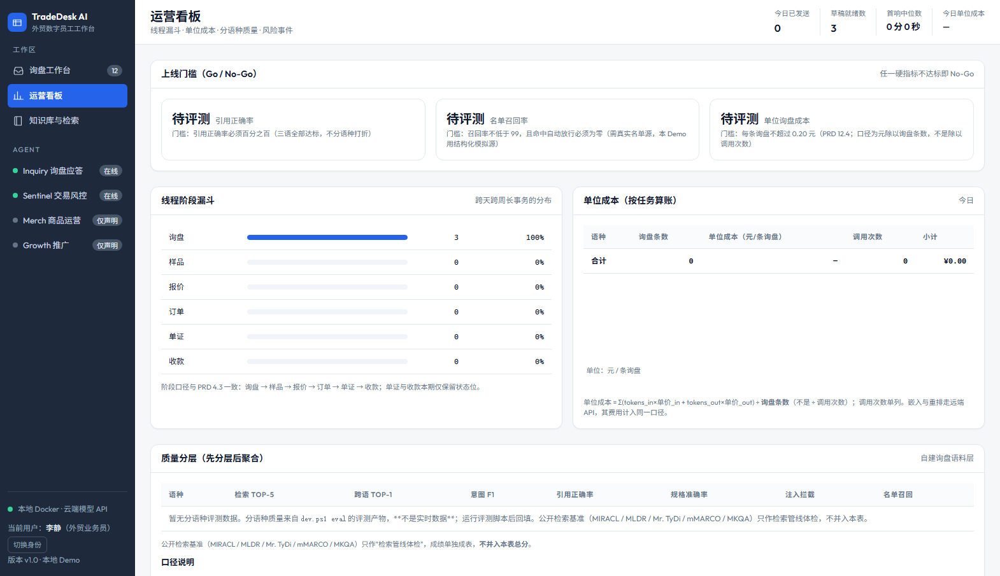
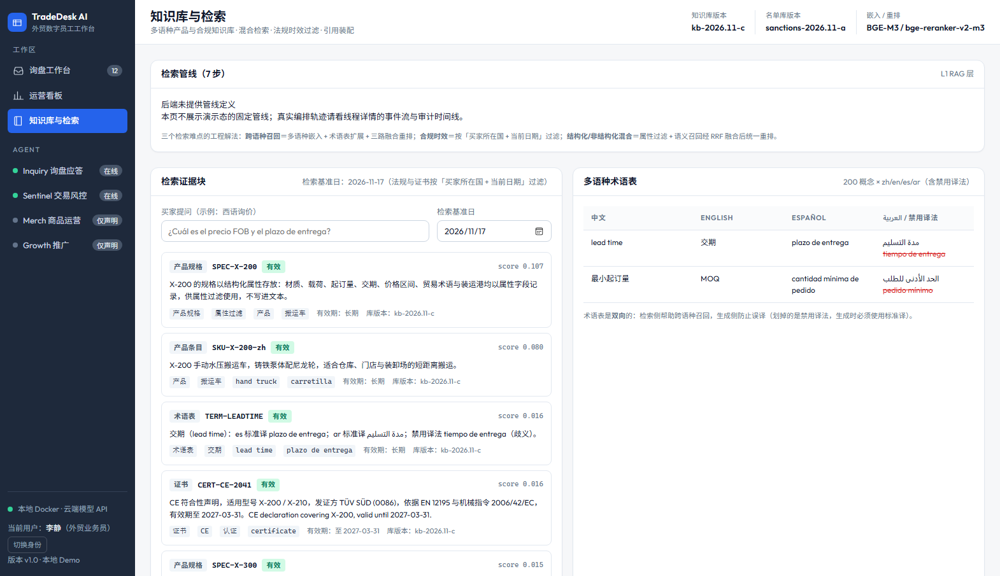

# TradeDesk-AI —— 外贸业务员的 AI 数字员工工作台

> 配套文档：`PRD-外贸业务员的AI数字员工工作台-v1.0.md`（产品需求，14 章）
> 前端原型：`ui-prototype/`（四页可交互原型：登录 / 工作台 / 看板 / 知识库；双击 `index.html` 看 mock 模式，`dev.ps1 serve` 后访问 `/ui/` 看真数据模式）

## 这是什么

**给中小外贸团队的 AI 数字员工工作台** —— 把询盘应答、客户背调、商品运营、投放推广、交易风控拆给五个 Agent，
业务员只做**价格谈判与合同确认**。本仓库交付其中三条的**可运行实现**：
询盘应答 Agent（Eva）+ 多语种知识库、交易风控 Agent（Grace）+ 人工签核闸门、调度器路由与询盘线程状态机。

> 红线：**询盘自动应答、报价人工签核、合同必须人工确认**。写操作与发送分离，Agent 只产出草稿。

| 询盘工作台（三语真数据） | 运营看板（门槛口径） | 知识库与检索（跨语种召回） |
| --- | --- | --- |
|  |  |  |

## 三个关键点

1. **AI 出草稿，不做决定** —— 11 条闸门 + 一次性闸门令牌绑定写操作；人签核后才发得出去。
2. **外贸最难的不是模型，是时间与确定性** —— 跨天跨周的 8 状态长事务（询盘 → 样品 → 报价 → 订单 → 单证 → 收款），
   断点续传 + 幂等 + 乐观锁；灰度**按企业**分流，同一买家永远拿到同一版本（按请求随机在报价场景是事故）。
3. **能被证伪才算数** —— 公开检索基准只做"多语种检索管线体检"，询盘场景另用自建多语种语料单独评测；
   厂商数字一律标注"厂商自述口径"，不与自建结果混算。

## 证据（都可复跑）

| 项 | 数字 |
| --- | --- |
| 交付门禁 | **十三步全绿**（`dev.ps1 check`：双后端 + 独立审核） |
| 单元测试 | **262 项** |
| 自证脚本（双后端） | S1 53 / S2 97 / S3 52 / S4 60 / S5 54 / S6-3 91 |
| 独立审核脚本（双后端） | S2 106 / S3 90 / S4 85 / S5 54 / S6 64 / S6-3 67 |
| 代码规模 | 源码 9.7k · 验证与审核脚本 9.7k · 单测 3.0k · 前端 2.3k · 文档 5k |

**实现被一份"先于实现写定"的判据证伪过三轮，共修 11 个根因**（含：灰度档把试点企业静默踢出、
双索引因单列主键根本不成立、审批人可由请求体自称、任何角色都能建发布）—— 修复记录见
[docs/S6-FIX-R22.md](docs/S6-FIX-R22.md)。

## 快速开始

```powershell
& ".\dev.ps1" up      # PostgreSQL 16 + Redis 7（Docker）
& ".\dev.ps1" serve   # http://127.0.0.1:8080/ui/   演示账号：sales / demo1234
& ".\dev.ps1" check   # 十三步交付门禁
```

> 作品集材料：[一页纸](docs/PORTFOLIO.md) · [架构图](docs/ARCHITECTURE.md) · [3 分钟演示脚本](docs/DEMO-SCRIPT.md)

## 当前进度

| 切片 | 内容 | 状态 | 验证方式 |
| --- | --- | --- | --- |
| **S1** | 时间维度骨架：状态机 + 存储（SQLite & PostgreSQL）+ 闸门令牌 + 审计哈希链 | ✅ 已完成 | `python scripts/verify_s1.py --backend both`（53 项 × 2 后端） |
| **S2** | Supervisor 路由与仲裁 + Handoff 15 字段契约 + FastAPI 接口 + 闸门令牌守卫（绑定动作）+ AgentSpec/注册表 | ✅ 已完成 | `python scripts/verify_s2.py`（97 项）+ `dev.ps1 audit`（独立审核 106 项） |
| **S3** | Sentinel 名单核验 + Inquiry 草稿装配 + 检索骨架 | ✅ 已完成（R11/R12/R14 审核 → R13/R16 修复） | `python scripts/verify_s3.py`（52 项）+ `dev.ps1 audit3`（90 项） |
| **S4** | 检索层：词法 + 结构化 + 稠密三通道 RRF（BGE-M3 / pgvector 可替换）+ 评测基线 | ✅ 已完成（R15/R17 审核 → R16/R18 修复；语料扩量见 `docs/NEXT.md` S4-4c 续） | `python scripts/verify_s4.py`（60 项）+ `dev.ps1 audit4`（SQLite 78 / PG 85 项） |
| **S5** | 多云厂商 provider 层（5 家）+ 真模型出稿 + 成本落库 + 分语种评测 | ✅ 已完成（R19 审核 → R20 修复） | `python scripts/verify_s5.py`（离线 18 项）+ `dev.ps1 audit5`（54 项） |
| **S6-5** | 企业知识库导入：CSV/JSON → 字段映射与校验 → 新库版本 → 显式建索引 → 走发布灰度 | ✅ 已交卷 | `python -m pytest tests/test_kb_import.py -q`（19 项） |
| **S6** | 前端联调 + 镜像构建 + 灰度回滚 | ✅ 五个切片全部交卷（1a / 1b / 2 / 3 / 4；S6-3 待审核核验） | `python scripts/verify_s6.py`（Python 24 + Node 27 项）+ `dev.ps1 audit6`（49 + 渲染层 15 项）+ `python scripts/verify_s6_3.py`（91 项 × 双后端） |

## 本机环境（已实测）

| 项 | 实际情况 | 处理 |
| --- | --- | --- |
| Docker Desktop | **已安装并运行**（server 29.6.2 / compose v5.3.1），但 CLI 在 `AppData` 下，沙箱内不可见 → 需用完整路径 `C:\Users\DELL\AppData\Local\Programs\DockerDesktop\resources\bin\docker.exe` 调用 | 依赖服务用 compose 起 |
| Docker Hub | **拉取被网络阻断**（registry-1.docker.io 不可达） | 改用本机已缓存镜像：`postgres:16-alpine`、`redis:7-alpine`；pgvector 改本地构建（`docker/pgvector/Dockerfile`） |
| 可用解释器 | `C:\Users\DELL\.cache\codex-runtimes\codex-primary-runtime\dependencies\python\python.exe`（3.12.14） | **用这个**。`D:\anaconda\python.exe` 的 `_ssl` DLL 损坏，装不了依赖 |
| 项目虚拟环境 | `.venv/`（已创建，pydantic + pytest + psycopg3） | `PYTHONNOUSERSITE=1` |
| 数据库 | PostgreSQL 16.15 容器（127.0.0.1:5433）+ Redis 7 容器（127.0.0.1:6380） | `docker compose up -d db redis` |

## 快速开始（推荐：dev.ps1，可在任意目录调用）

```powershell
$dev = "D:\桌面\AIagent_project\外贸项目\dev.ps1"

& $dev up        # 起 PostgreSQL 16(5433) + Redis 7(6380)
& $dev check     # 交付前自检（十三步）：语法 + S1 双后端 + S2/S3 自证 + pytest + S2…S6/S6-3 独立审核
& $dev verify    # 双后端验证（S1，53 项 × 2）
& $dev test      # pytest（280 项）
& $dev status    # 看容器与端口
& $dev push      # 推送当前分支到 GitHub（git 优先，失败自动切 API）
& $dev release   # 发布与灰度命令行（status / create / advance / rollback / resolve）
& $dev down      # 停容器

& $dev verify -Backend postgres   # 只跑 Postgres 后端
```

> `dev.ps1` 会自动定位项目根、docker.exe 与项目虚拟环境，**不需要先 cd 进项目目录**。

## 手动命令（需先 cd 到项目根）

```powershell
cd "D:\桌面\AIagent_project\外贸项目"

# 依赖服务
$docker = "C:\Users\DELL\AppData\Local\Programs\DockerDesktop\resources\bin\docker.exe"
& $docker compose up -d db redis

# 验证与测试
& .\.venv\Scripts\python.exe scripts\verify_s1.py --backend both
& .\.venv\Scripts\python.exe -m pytest -q
```

> `verify_s1.py` 每次运行都会重建存储并输出逐项 PASS/FAIL，退出码 0 表示全通过。
> 建议节奏：**每完成一个切片就跑一次**，回归时用 `--backend both`。


## 文件夹说明（每一项都是干什么的）

| 路径 | 说明 | 能不能删 |
| --- | --- | --- |
| `PRD-外贸业务员的AI数字员工工作台-v1.0.md` | 产品需求文档（唯一的产品真相） | 不能 |
| `README.md` | 本文件：怎么跑、当前进度 | 不能 |
| `dev.ps1` | 日常入口：`up / down / check / verify / test / audit… / index / serve / push / clean / status` | 不能 |
| `src/tradedesk/domain/` | 领域层：枚举、模型（线程状态/承诺台账/草稿/引用/令牌/审计）、状态机 | 不能 |
| `src/tradedesk/store/` | 存储层：`base.py` 接口 + `sqlite_store.py` + `postgres_store.py`（同接口双实现） | 不能 |
| `src/tradedesk/runtime/gates.py` | 11 条人审闸门 + 闸门令牌服务 | 不能 |
| `src/tradedesk/data/seed.py` | 演示数据（名单为结构化演示数据，**非真实名单**） | 不能 |
| `src/tradedesk/config.py` | 配置读取（环境变量 > .env > 默认值） | 不能 |
| `scripts/verify_s1.py` | **验证脚本**：跑完自动清理临时物；`--keep` 保留现场，`--self-delete` 用完即焚 | 可（用完即焚） |
| `tests/` | pytest 用例（234 项，PostgreSQL 用例在容器未启动时自动跳过） | 不能 |
| `docker-compose.yml` | 依赖服务：PostgreSQL 16(5433) + Redis 7(6380) | 不能 |
| `docker/pgvector/Dockerfile` | 本地构建 pgvector 镜像的配方（S4 用，因为 Docker Hub 拉不动） | S4 前可留 |
| `Dockerfile` | 应用镜像（S2 起使用） | 不能 |
| `ui-prototype/` | 前端四页原型（登录/工作台/看板/知识库）；mock 双击即看，真数据走 `dev.ps1 serve` | 不能 |
| `ui-prototype/design-system/` | ui-ux-pro-max 生成并持久化的设计系统（原型用的令牌与规则） | 可删（原型自带样式） |
| `.venv/` | 项目虚拟环境（pydantic / pytest / psycopg3） | **删了要重装** |
| `data/` | 运行时数据目录（主库文件、临时目录），验证后会保持为空 | 可（会自动重建） |
| `.env.example` | 配置模板，复制成 `.env` 后填 MiniMax Key | 不能 |
| `.gitignore` / `pytest.ini` / `requirements.txt` | 常规工程文件 | 不能 |

### ⚠ 两条硬规矩（都踩过坑）

1. **所有 `.ps1` 必须存成 UTF-8 with BOM**。Windows PowerShell 5.1（你终端里的那个）会把无 BOM 的脚本按 GBK 读，中文乱码 → 整段语法解析失败。PowerShell 7 无所谓，但为了两端一致，统一带 BOM。
2. **Python 脚本不要强制 UTF-8 输出**。`verify_s1.py` 已改成自适应：交互式控制台沿用控制台原生编码（中文 Windows 是 GBK/CP936，终端里显示正常），被重定向或抓取时才用 UTF-8。

> 交付前自检：在 **Windows PowerShell 5.1** 下跑 `& $dev check`，十三步全绿再交付。
> 验证方式：`powershell.exe -NoProfile -ExecutionPolicy Bypass -File "<项目>\dev.ps1" check`
### 发布到 GitHub

网页版 `github.com/new` 在本机网络下会报「Couldn't check availability」（api.github.com 可达，但网页那个查询请求超时），所以走脚本：

```powershell
# ① 先到 https://github.com/settings/tokens/new 建 Token（classic，勾 repo 权限）
# ② 自检（不联网、不需要 Token）
& ".\scripts\publish_github.ps1" -DryRun
# ③ 建私有仓库并推送 main / agent-a / agent-b（会提示输入 Token，不回显）
& ".\scripts\publish_github.ps1"
# 想建公开仓库：加 -Public
```

Token 只在本机内存里用：通过 `GIT_ASKPASS` 传给 git，**不写进 `.git/config`、不进命令行历史、不进聊天记录**。
推送策略：**现在推私有库做备份与协作底座，全部切片完成、README 整理好之后再转公开。**

### 保持目录干净的三条规矩

1. **验证脚本结束即清理**：每次 `verify` 跑完会自动删掉 SQLite 临时库、清空 PostgreSQL 表、删除 `data/tmp`。
2. **临时目录固定在项目内**：pytest 不用自带的 `--basetemp`（受限 ACL 下会 PermissionError），改用 `tests/conftest.py` 的 `tmpdir_local`。
3. **`dev.ps1 clean`**：一次性清掉验证残留、`.pytest_cache` 与 `src/tests/scripts` 下的 `__pycache__`（不会动 `.venv`）。

```powershell
# 想看验证过程中的中间产物：
& $dev verify -Backend postgres --keep     # 保留临时库，便于用 psql 查
# 用完即焚（连脚本一起删）：
& .\.venv\Scripts\python.exe scripts\verify_s1.py --backend both --self-delete
```

## 目录结构

```
src/tradedesk/
├── config.py             配置（环境变量 > .env > 默认值）
├── domain/
│   ├── enums.py          阶段 / 风险 / 意图 / 闸门 / 事件类型
│   ├── models.py         线程状态、客户档案、承诺台账、草稿、引用、令牌、审计
│   └── state_machine.py  8 状态迁移表 + 前置条件 + 幂等（纯函数，可穷举测试）
├── store/
│   ├── base.py           StateStore 接口 + 共享的审计哈希算法
│   ├── sqlite_store.py   SQLite 实现（零依赖、便于单机验证）
│   └── postgres_store.py PostgreSQL 16 实现（与 SQLite 同一接口，可替换）
├── runtime/
│   ├── gates.py          11 条人审闸门 + 闸门令牌服务（一次性消费）
│   ├── handoff.py        Handoff 契约：15 个必填字段，缺一即拒
│   └── supervisor.py     调度器：意图路由 / 风控优先仲裁 / 幂等 / 签核 / SLA
├── agents/
│   ├── inquiry.py        询盘应答 Agent（意图识别 + 草稿装配 + 引用；已接真模型，价格走占位符）
│   ├── draft_writer.py   模型出稿（占位符回填 + 数字白名单 + 越权判定 + 降级回模板）
│   ├── prompts.py        Prompt 资产（买家消息视为数据，注入防护）
│   ├── sentinel.py       交易风控 Agent（名单核验 + 风险分级 + 证据链）
│   └── registry.py       角色注册表（Merch/Growth 仅声明，调用返回未实现）
├── llm/                  多云厂商层：providers（5 家注册表）/ factory / chat / pricing（成本计量）
├── retrieval/            检索层：词法 + 结构化 + 稠密三通道 RRF、嵌入器、向量索引、时效过滤
├── api/
│   ├── app.py            FastAPI 接口层（只搬运参数与鉴权，不写业务规则）
│   ├── auth.py           登录与会话（账号口令 + 四类角色可见域，S6-4）
│   ├── workbench.py      工作台读模型 BFF（GET /workbench，S6-1a）
│   └── deps.py           依赖装配 + 闸门令牌守卫（无令牌写操作一律 403）
└── data/                 seed.py 演示数据 + kb_seed.py 知识库 + inquiry_corpus.py 自建询盘语料（160 条缩减版）
docker/
└── pgvector/Dockerfile   本地构建 pgvector 镜像（Docker Hub 不可达时的路径）
docker-compose.yml        db（PostgreSQL 16）+ redis
Dockerfile                应用镜像（S2 起使用）
scripts/verify_s1.py      S1 验证脚本（双后端）
scripts/verify_s2.py      S2 验证脚本（编排 + HTTP + 闸门，97 项）
tests/                    pytest 用例（234 项）
```

## 设计要点（为什么这么写）

| 决策 | 原因 |
| --- | --- |
| 状态迁移是**纯函数** | 可穷举测试、可回放；不把 IO 和规则混在一起 |
| 前置条件写进**迁移表** | 进入订单必须有合同版本这类规则，不散落在业务代码里 |
| 闸门令牌**服务端签发、一次性、绑定线程与草稿** | 写操作的凭证不能由 Agent 自己声称"已获批准" |
| 审计**哈希链** | 只追加之外还要"可验伪"：篡改一条就能定位到 seq |
| 存储做成**接口 + 两套实现** | PRD 13.4.5 选型轴②的可替换性；SQLite 便于每天验证，PostgreSQL 贴近生产 |
| 名单用**结构化演示数据** | 真实名单源需要商用授权（PRD 13.4.12）；演示数据必须显式标注 |