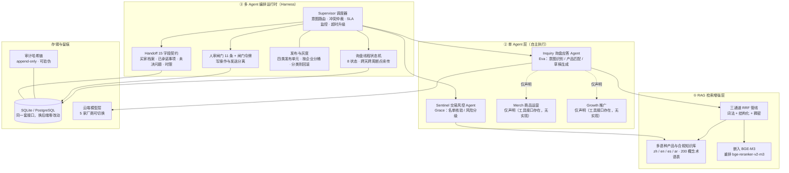
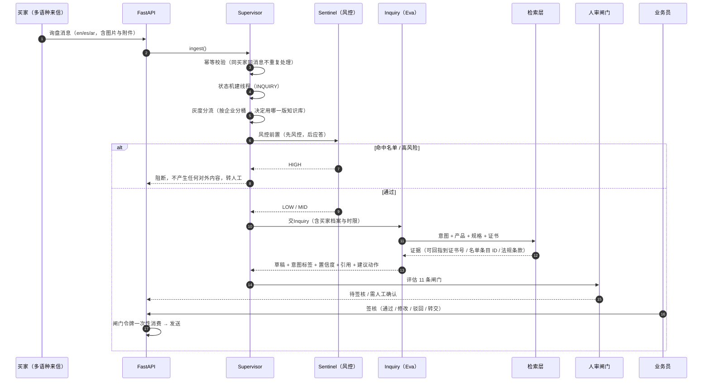
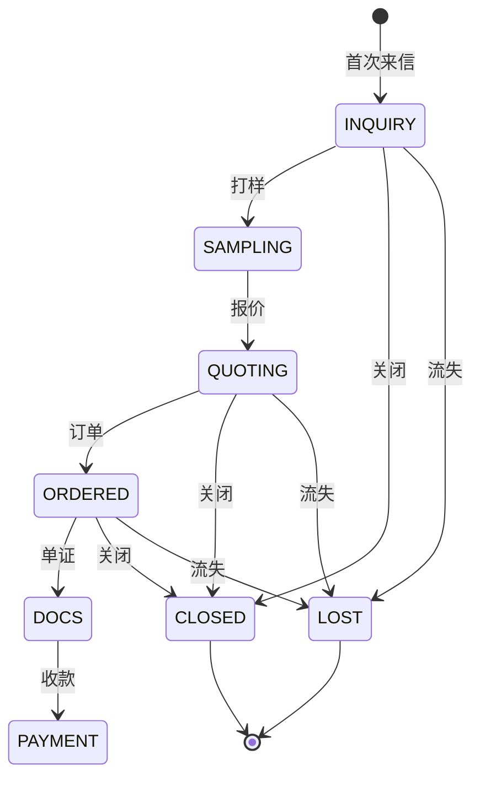
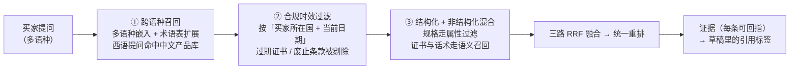
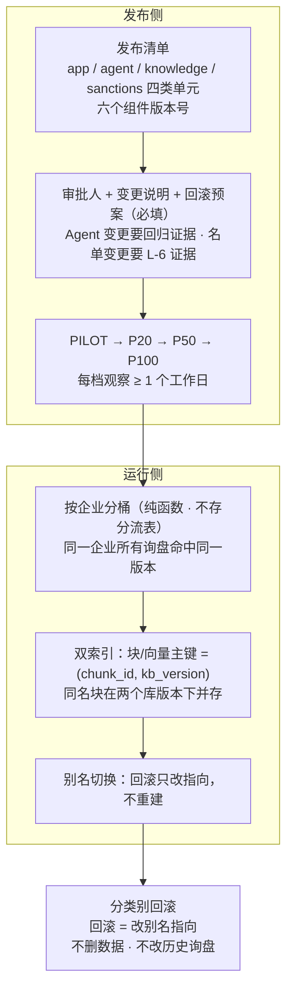

# 一页架构（TradeDesk-AI · 外贸业务员的 AI 数字员工工作台）

> 与代码一一对应；图里的每个方框都能在 `src/tradedesk/` 里找到同名模块。
> 本期交付范围：PRD 第 1 章第 22 行 —— **询盘应答 Agent + 多语种知识库 / 交易风控 Agent + 人工签核闸门 / 调度器路由与询盘线程状态机**；
> Merch、Growth 两个角色**只声明不实现**（图中用虚线标出）。

---

## 一、三层能力总览

**红线**：Agent 只产出**草稿**，报价与合同必须人工签核；不自动签合同、不自动定价、不自动付款。

---

## 二、一次询盘的处理时序

---

## 三、询盘线程状态机（跨天跨周的长事务）

- **断点续传**：线程、事件、审计、闸门令牌全部落库，进程重启后从上次位置继续（PRD 4.3）。
- **乐观锁**：并发更新撞版本号 → 409 而不是静默覆盖。
- 单证 / 收款本期只保留状态位（本期不做）。

---

## 四、检索管线：三个难点的工程落法

> 检索分**两层口径**：公开检索基准（MIRACL / MLDR / Mr. TyDi / mMARCO / MKQA）只证明"多语种检索管线没问题"；
> 询盘场景做得好不好，由**自建多语种询盘语料层**单独评测。两者不混算（PRD 9.5）。

---

## 五、灰度与回滚（S6-3，PRD 13.4.8）

**三个容易做错的地方**（本项目实际踩过并已修）：

1. 块与向量主键若只有 `chunk_id`，建新版本会顶掉旧版本 → 双索引根本不成立；
2. 灌基线若整库清空，重启一次灰度就没了；
3. `index_version` 若只是清单里的一个字段没人消费，改了等于没改。

---

## 六、模块地图

| 层 | 模块 | 职责 |
| --- | --- | --- |
| domain | `state_machine` `agentspec` `models` `enums` | 8 状态迁移、角色契约、领域模型（纯函数，无 IO） |
| runtime | `supervisor` `gates` `handoff` `watchdog` | 路由与仲裁、11 条闸门与闸门令牌、15 字段交接、SLA 扫描 |
| agents | `inquiry` `sentinel` `draft_writer` `prompts` `registry` | Eva、Grace、模型出稿、提示词资产、角色注册表 |
| retrieval | `pipeline` `lexical` `indexer` `store_retriever` `embedders` | 三通道 RRF、向量索引、按库版本取块的检索器 |
| release | `manifest` `bucketing` `service` | 发布清单、按企业分桶、推进与分类别回滚 |
| api | `app` `deps` `auth` `workbench` | HTTP 接口、依赖装配、本地账号会话、读模型 BFF |
| store | `base` `sqlite_store` `postgres_store` | 同一套接口，换后端业务代码零改动 |
| llm | `providers` `factory` `chat` `pricing` | 5 家厂商可切换、成本按来源与取数日期维护 |